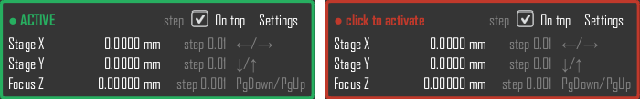

pymodaq_plugins_keyboardjog
###########################

.. image:: https://img.shields.io/pypi/v/pymodaq_plugins_keyboardjog.svg
   :target: https://pypi.org/project/pymodaq_plugins_keyboardjog/
   :alt: Latest Version

.. image:: https://github.com/PyMoDAQ/pymodaq_plugins_keyboardjog/actions/workflows/tests.yml/badge.svg
    :target: https://github.com/PyMoDAQ/pymodaq_plugins_keyboardjog/actions/workflows/tests.yml

**Keyboard Jog** is a PyMoDAQ Dashboard extension: a tiny, always-on-top window to move the actuators of the
Dashboard with the keyboard (arrow keys for a pair of axes, keys of your choice for single actuators), while
showing their current position. It is made for alignment work: centering a beam, finding a sample, focusing...

   Green border: the window has the keyboard focus, the keys move the actuators. Red border: keys are ignored.

Authors
=======

* RCazali (romcazali@gmail.com)

Extensions
==========

* **Keyboard Jog**: move the Dashboard actuators with the keyboard

  * **Focus indicator** (main safety feature): the window border is **green** when it has the keyboard focus (the
    keys move the actuators) and **red** otherwise (every key is ignored). Click the window to activate it.
    Clicking in the settings tree also makes it red: typing a value never moves an actuator.
  * **Works without configuration**: every actuator of the Dashboard is shown with a number, the first one is
    selected. Keys **1-9, 0** (or a click on a row) select an actuator, **W A S D** move the selection.
  * **Movement keys**: W A S D are recognized by their position on the keyboard (Windows, Linux), so they are the
    Z Q S D keys of an AZERTY keyboard (the labels follow the input language). The arrows can be used instead, or
    both (setting *Move keys*).
  * **Main view**: one compact row per displayed actuator: number, name, live position with units, step size, keys.
    The selection is marked with ▶ and its keys are shown.
  * **Settings of each actuator** (*Settings > Actuators*, or right-click its row): *Display*, *Continuous*,
    *Step*, *Pair* (``auto``, 1..9, 0) and *Keys* (``horizontal``: A / D, ``vertical``: S / W; horizontal by
    default). An actuator on ``auto`` takes the first free number.
  * **Pairs**: two actuators with the same pair number form one group, selected by that number and moved together:
    the horizontal one with A / D, the vertical one with S / W (e.g. the X and Y of a stage). Quicker: right-click
    a row, *Pair 'X' with ▸ Y* (X horizontal, Y vertical). Right-click a pair to rename or unpair it.
  * **Extra keys** (settings): two keys of your choice (e.g. PgDown / PgUp for a focus) that always move an
    actuator, whatever the selection. A key used twice is reported in the settings and disabled.
  * **Step size** per actuator, in its units. ``+`` multiplies the step of the selection by the step factor (10 by
    default), ``-`` divides it.
  * **Step mode** (default): one key press = one relative move of one step. Holding the key does nothing more.
  * **Continuous mode** (per actuator, shown as ``cont.`` in the main view): steps are repeated while the key is
    held, each one sent only once the previous move is done (moves are never queued), with an optional minimum
    interval. While held, **Shift** = step x10, **Ctrl** = step /10 (the stored step is unchanged).
  * **History** (graph button, hidden by default): the end-of-move positions of the selected group, whatever moved
    it, in 2D for a pair (old points grey, recent ones yellow, live position as a cross). Hover a point for its
    values and time, click it to go back there (after confirmation, ``move_abs``). Kept in
    ``<PyMoDAQ local folder>/KeyboardJog/history.json`` (2000 points per group). The value of an actuator is
    highlighted in orange while it moves.
  * **Safety**: OS auto-repeat is ignored, a key press arriving while the actuator is still moving (or moved by
    something else: a scan, its own module...) is dropped, releasing the key stops the repetition at once, and
    losing the focus clears every held key and (option, on by default) stops the actuators moved by this window.
  * **Setups**: the complete configuration (settings of each actuator, pair names, extra keys, options,
    always-on-top, history shown) is saved / loaded / deleted by name from the settings, as XML files (PyMoDAQ
    parameter-tree format) in ``<PyMoDAQ local folder>/KeyboardJog/setups``. The last setup is reloaded at startup.
    A setup referring to an actuator that is not in the Dashboard loads anyway: that actuator is skipped and a
    warning is shown. The setups of version 0.1 (pairs and one motion mode for all) are converted when loaded.

All the motion goes through the ``DAQ_Move`` modules already loaded in the Dashboard, with their public API only
(``move_rel``, ``move_abs`` for the history, ``stop_motion``, ``current_value_signal``, ``move_done_signal``): no
hardware access, zero connection configuration.

Usage
=====

1. Load a Dashboard preset (PyMoDAQ 5.1) or experiment (5.2+) with actuators, initialize them.
2. Open *Extensions > Keyboard Jog*. Click the window (green border).
3. Press ``1``, ``2``... (or click a row) to select an actuator, move it with W A S D, adjust its step with
   ``+`` / ``-``.
4. Right-click a row to pair two actuators (X / Y of a stage), make one vertical or continuous; or set the same
   *Pair* number to two actuators in *Settings > Actuators*.
5. Optional: the graph button shows the history; in *Settings*, *Add extra keys* (e.g. ``PgDown`` / ``PgUp``),
   movement keys, then save the setup (*New name*, *Save as*).

Keys used by the extension: W A S D (by position) and / or the arrows, ``1``-``9``, ``0`` (top row or keypad; the top row
also works without Shift on an AZERTY keyboard, on Windows and Linux), ``+`` (and ``=``), ``-``, Shift, Ctrl, Alt and
Tab.

Development launch with the mock actuators of ``pymodaq_plugins_mock``::

    python -m pymodaq_plugins_keyboardjog.tools.mock_config            # writes the 'keyboard_jog_mock' preset / experiment
    python -m pymodaq_plugins_keyboardjog.extensions.keyboard_jog keyboard_jog_mock

Installation instructions
=========================

* PyMoDAQ 5.1.x or newer: tested with PyMoDAQ 5.1.10 (Python 3.11, PyQt5) and 5.3.4 (Python 3.12, PyQt6).
* Any operating system supported by PyMoDAQ (developed and tested on Windows 11).
* No driver: the extension only uses the actuators of the Dashboard.

::

    pip install pymodaq_plugins_keyboardjog

or, for development, ``pip install -e .`` in a clone of this repository, then ``pytest``.

To be discussed (not implemented)
=================================

Keyboard layout independence for the extra keys (physical keys / AZERTY-QWERTZ presets), axis inversion / swap per pair, emergency stop key, software limits and maximum step, lock during scans, display
interactions (absolute position entry, mouse wheel), named position memory, gamepad support (the input
handling is already "input source -> action"), true continuous motion (needs DAQ_Move evolutions), smart default
pairs on first launch.
